# GammaOS Pico

A retro handheld OS for the **Konkr Pocket Advance** and the **Konkr Pocket Block**, living in the
console's bootloader. It plays your games straight from the microSD card, and leaves
the console's Android in place.

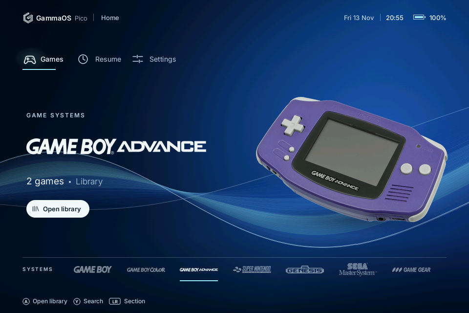

## Systems supported

| System | Emulator | Files |
|---|---|---|
| Game Boy Advance | armGBA (default), gpSP | `.gba` |
| Game Boy | gambatte | `.gb` |
| Game Boy Color | gambatte | `.gbc` |
| NES / Famicom | armNES | `.nes` `.unf` |
| Famicom Disk System | armNES | `.fds` (needs the Disk System BIOS) |
| Super Nintendo (SNES) | snes9x | `.sfc` `.smc` |
| Mega Drive / Genesis | Genesis Plus GX | `.md` `.gen` `.bin` `.smd` |
| Master System | Genesis Plus GX | `.sms` |
| Game Gear | Genesis Plus GX | `.gg` |
| SG-1000 | Genesis Plus GX | `.sg` |

Any of them can also be in a `.zip` or `.7z` archive.

## Consoles

| | Konkr Pocket Advance | Konkr Pocket Block |
|---|---|---|
| Chip | MediaTek MT6785 | MediaTek MT8786, 960 x 720 screen |
| Supported since | 1.0.0 | 1.0.2 |
| Bootloader slots written | `lk_a` and `lk_b` | `lk_a` (the slot the console starts from) |
| Packages | `gammaos-pico-kpa-*` | `gammaos-pico-block-*` |
| Tilt, gyro and rumble | yes | yes, from 1.1 |
| Wi-Fi and Bluetooth | yes, from 1.1 | yes, from 1.1 |

Both run the same system: the same menus, emulators, saves and settings. **The same microSD card
works in both consoles**: it holds the menus for both screens.

## Read this first

> [!CAUTION]
> **GammaOS Pico is a custom bootloader. It is experimental software, provided as it is, with no
> warranty of any kind.** Installing it replaces the console's bootloader (the LK, in `lk_a` and
> `lk_b` on the Konkr Pocket Advance, in `lk_a` on the Konkr Pocket Block). Flashing a bootloader can leave a console that does not start, and you do it entirely at
> your own risk. Nobody involved is responsible for a bricked or damaged console, lost data, or
> anything else that comes from installing or using it.

> [!WARNING]
> **The console's Android stays** as it is: pull the card, or pick Boot to Android in the menu,
> and it starts Android. **But Android's over-the-air (OTA) updates may stop working** while
> GammaOS Pico's bootloader is installed, and an OTA may also replace it. **Update the console's
> Android to its latest version before you install GammaOS Pico.** On the Konkr Pocket Block an
> Android update installs into the console's second slot and switches to it, which starts that
> slot's stock bootloader: install the GammaOS Pico bootloader again after one.

> [!IMPORTANT]
> **GammaOS Pico works fully offline, and is released as it is.** Wi-Fi, Bluetooth and a
> RetroAchievements account are optional and off until you use them; there is no store and no
> account of its own. It is not a community project: **feature requests, issues and pull requests are not
> accepted**, and there is no support channel here. Use it as it is, or not at all.

## Download

The [**Releases**](https://github.com/TheGammaSqueeze/GammaOSPico/releases) page has, for each
version, a set of packages for each console. For 1.1.2:

| | Konkr Pocket Advance | Konkr Pocket Block |
|---|---|---|
| The bootloader | `gammaos-pico-kpa-1.1.2-flash.zip` | `gammaos-pico-block-1.1.2-flash.zip` |
| The microSD card | `gammaos-pico-kpa-1.1.2-sdcard.zip` | `gammaos-pico-block-1.1.2-sdcard.zip` |
| Windows tools | `gammaos-pico-kpa-windows-tools.zip` | `gammaos-pico-block-windows-tools.zip` |

- **The flash zip**: the bootloader, with SP Flash Tool, mtkclient and fastboot packages, and the
  stock bootloader to go back. Use the one for your console: they are not interchangeable.
- **The sdcard zip**: the microSD card: the menu, the emulators, the Wi-Fi and Bluetooth firmware
  and a set of freely licensed demo games with their box art. Both consoles' sdcard zips hold the
  same card.
- **The windows-tools zip**: for installing on Windows, SP Flash Tool v5.1924 and MediaTek's USB
  driver, as MediaTek ships them (SP Flash Tool V6 does not work with the packages).

**You install the bootloader with SP Flash Tool v5 (Windows) or mtkclient (Linux).** Both write it
to a stock console without unlocking anything and without erasing your data. fastboot is only for
updates once GammaOS Pico is already on the console, never for the first install. Full steps are
in [Installing](https://github.com/TheGammaSqueeze/GammaOSPico/wiki/Installing).

## How to

Everything is in the [**Wiki**](https://github.com/TheGammaSqueeze/GammaOSPico/wiki), with
screenshots:

- [Before you start](https://github.com/TheGammaSqueeze/GammaOSPico/wiki/Before-You-Start)
- [Installing](https://github.com/TheGammaSqueeze/GammaOSPico/wiki/Installing): formatting the
  card (FAT32 or exFAT), the card's files, and flashing the bootloader with SP Flash Tool or mtkclient
- [Adding games](https://github.com/TheGammaSqueeze/GammaOSPico/wiki/Adding-Games): the folders
  and files it reads, archives, adding folders of your own
- [Box art](https://github.com/TheGammaSqueeze/GammaOSPico/wiki/Box-Art) and the
  [BIOS files](https://github.com/TheGammaSqueeze/GammaOSPico/wiki/BIOS) (Game Boy Advance, Famicom
  Disk System)
- [Using the menu](https://github.com/TheGammaSqueeze/GammaOSPico/wiki/Using-the-Menu),
  [Settings](https://github.com/TheGammaSqueeze/GammaOSPico/wiki/Settings),
  [the in-game menu](https://github.com/TheGammaSqueeze/GammaOSPico/wiki/In-Game-Menu),
  [buttons](https://github.com/TheGammaSqueeze/GammaOSPico/wiki/Buttons)
- [Wi-Fi and the Network tab](https://github.com/TheGammaSqueeze/GammaOSPico/wiki/Wi-Fi),
  [RetroAchievements](https://github.com/TheGammaSqueeze/GammaOSPico/wiki/RetroAchievements),
  [playing together over Bluetooth](https://github.com/TheGammaSqueeze/GammaOSPico/wiki/Playing-Together)
- [Updating, and going back to stock](https://github.com/TheGammaSqueeze/GammaOSPico/wiki/Updating-and-Going-Back)
- [Troubleshooting and FAQ](https://github.com/TheGammaSqueeze/GammaOSPico/wiki/Troubleshooting-and-FAQ)

## What it does

- From power on to the Game Boy Advance boot logo in about two and a half seconds; hold Power in
  a game to save your place and switch off, and the next power on goes straight back.
- Low latency: the screen is retimed to each console's real refresh rate, frames are paced to the
  panel and run-ahead hides the games' own lag.
- Sharper motion with black frame insertion: the backlight goes dark for part of every frame, in
  step with the screen, so moving pictures stay crisp instead of smearing (25 %, 50 % or 75 %).
- Rewind, fast forward (with a speed cap of your choice), save states, screen filters and colour
  correction, cheats, and every button and hotkey remappable.
- Box art, play time and last played for every game; search, A to Z and fast scrolling for
  libraries of thousands of games.
- Games in your own folders, ES-DE or EmuDeck layouts, and `.zip` / `.7z` archives.
- Wi-Fi: a Network tab to join networks (WPA2 and open, 2.4 and 5 GHz) with an on-screen
  keyboard, saved networks that join by themselves, and the clock set from the network.
- RetroAchievements on every system (softcore), with unlocks kept on the card when there is no
  network and sent later, an Achievements page in the in-game menu and cards over the game.
- Box art from the network: libretro's thumbnails matched by each game's contents (zipped games
  too), then ScreenScraper for the rest.
- Two consoles together over Bluetooth: Play together (NES, SNES, Mega Drive, Master System,
  Game Gear, and linked Game Boy, Game Boy Color and Game Boy Advance games, one copy of each game
  enough), started from the menu or from inside a game, and Send and Receive.
- Tilt, gyro and rumble (both consoles): the console's motion sensor and vibration motor
  stand in for the cartridges' (Yoshi Topsy-Turvy, WarioWare: Twisted!, Kirby Tilt 'n' Tumble, Drill Dozer and the
  Game Boy Color rumble cartridges).
- Headphones: sound moves to the 3.5 mm jack when they are plugged in.
- Game names in any language (accented letters, Greek, Cyrillic, Japanese, Chinese, Korean,
  Hebrew, Arabic), and menus in 17 languages.
- The console's real-time clock for the games that keep time.
- Everything (settings, saves, states, box art) lives on the card.

Screenshots captured on a Konkr Pocket Advance.

| | |
|---|---|
| 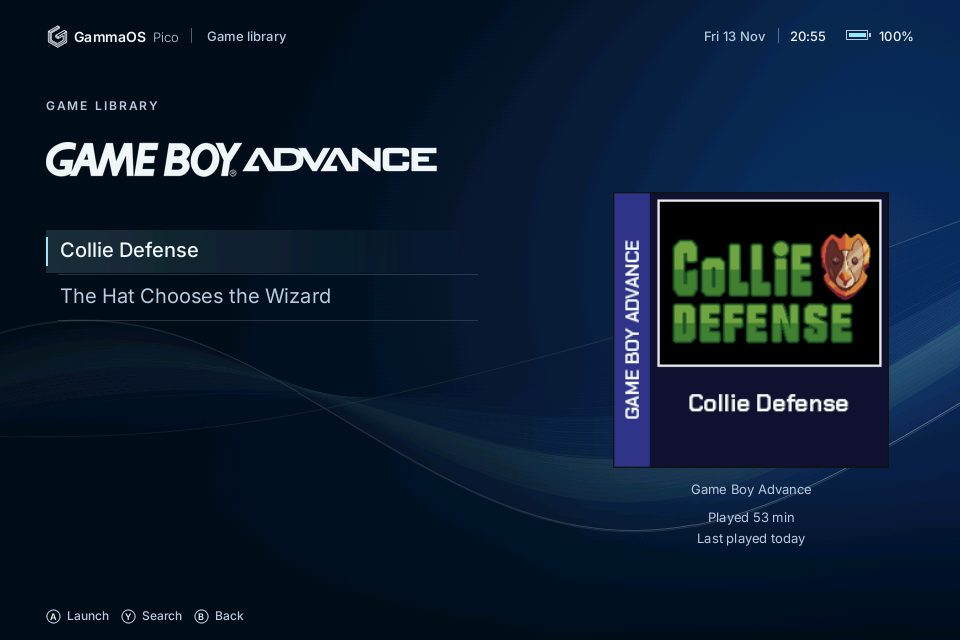 |  |
| A system's library, with box art and play time | The in-game menu over a game |
| 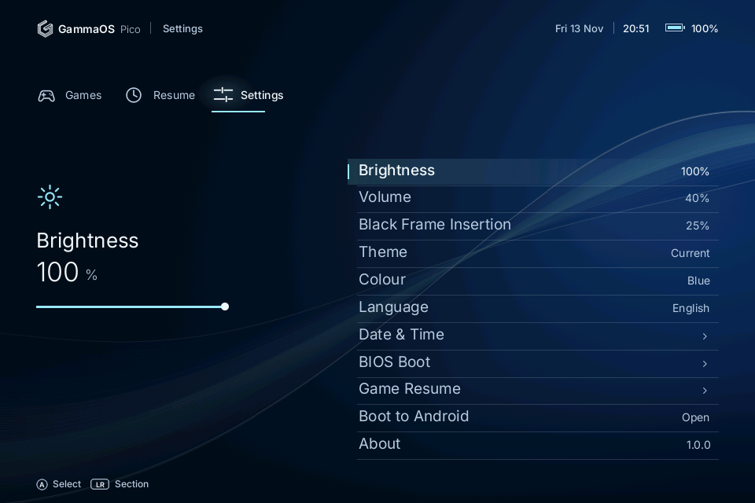 |  |
| Settings | armGBA's options, with Motion Controls and Rumble |
|  |  |
| Game names in any language | Search finds accented names by their plain letters |
| 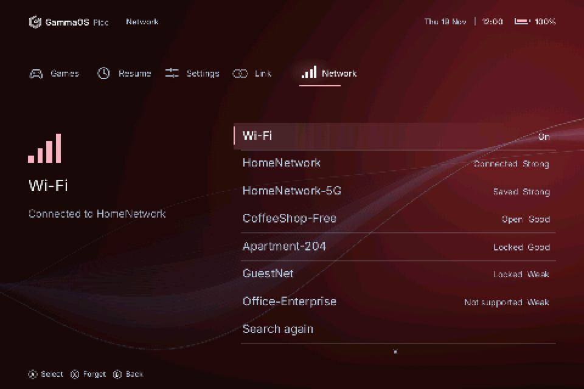 | 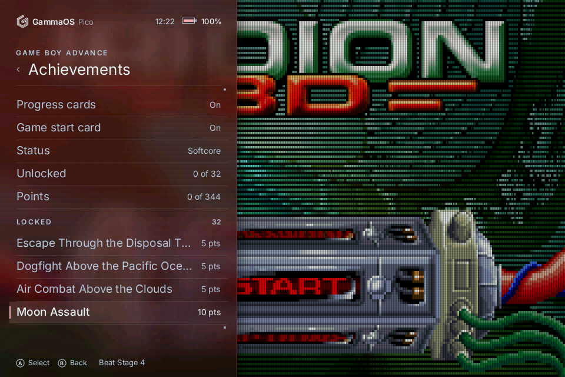 |
| Wi-Fi on the Network tab | A game's achievements in the in-game menu |
| 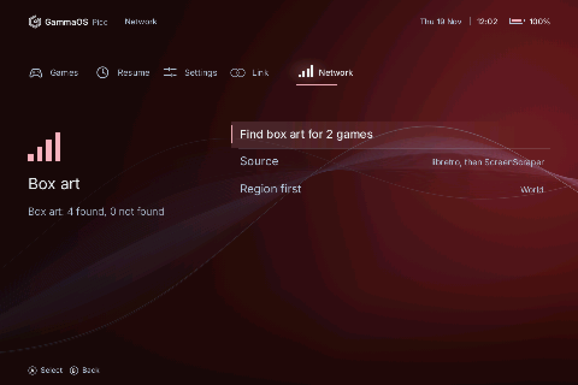 | 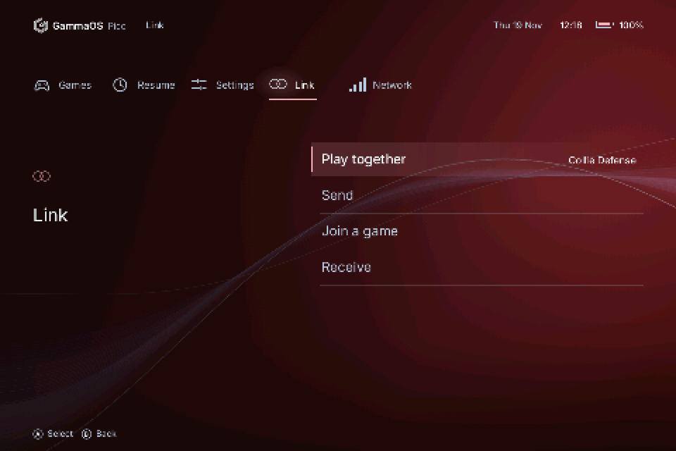 |
| Box art from the network | Play together over Bluetooth |
| 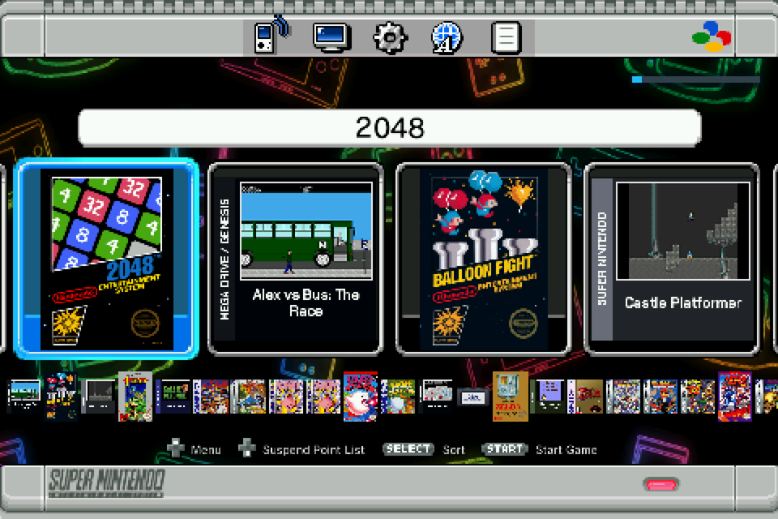 | 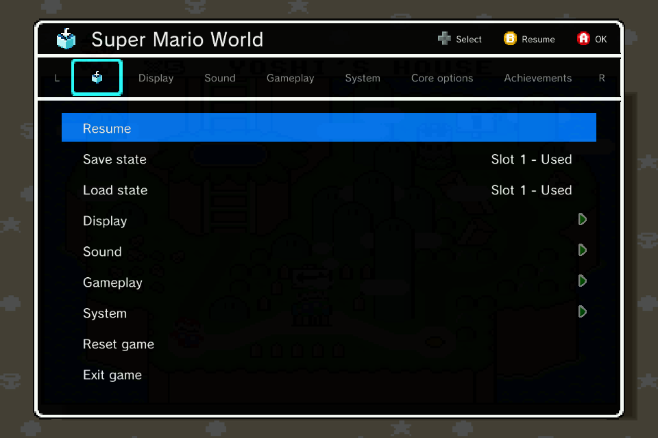 |
| The Classic theme, Link first in its menubar | The Classic themes' own in-game menu |
| 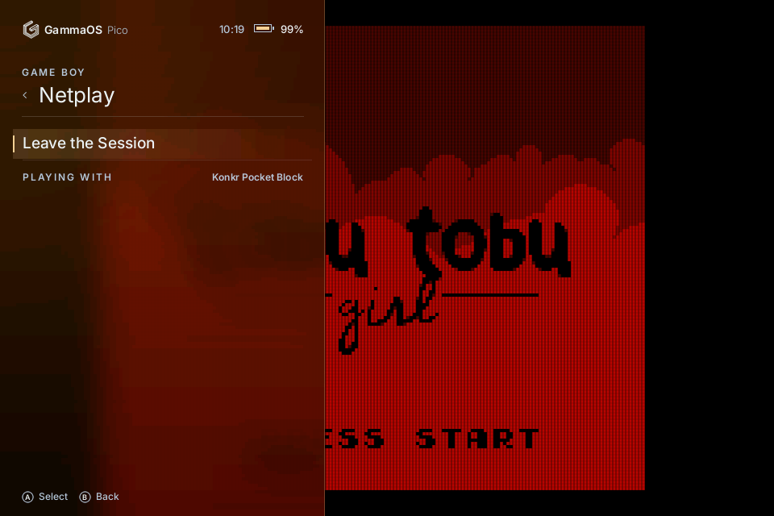 | 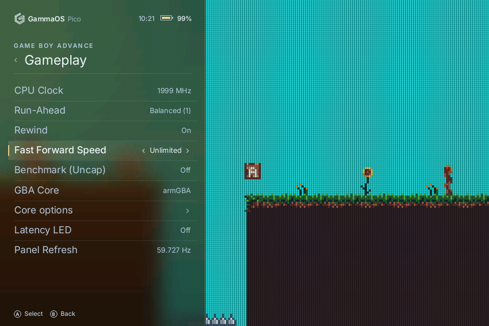 |
| Netplay from inside a game: a session with a Konkr Pocket Block | Fast Forward Speed on the Gameplay page |

## GammaOS Pico Tool

[**GammaOS Pico Tool**](https://github.com/TheGammaSqueeze/GammaOSPico-Tool) is the desktop
companion for Windows, macOS and Linux: it sets up and updates the card from these releases, lists
your games the way the console does, scrapes box art straight onto the card, and backs up, updates
and restores the console's bootloader once GammaOS Pico is installed. From version 1.0.3 it works
with both consoles (it writes `lk_a` and `lk_b` on the Konkr Pocket Advance, only `lk_a` on the
Konkr Pocket Block), and it uses the computer's own certificate store, so checking for the latest
release and scraping box art work on macOS too.

## Version

Each build shows its version and the commit it was built from in Settings > About (and over
fastboot as `version-gammaos-pico`). This is **GammaOS Pico 1.1.2**.

New in 1.1.2:

- **Faster fast forward**, in battles above all (a Pokemon LeafGreen battle about 4 to 5 times
  instead of 2), and a **Fast Forward Speed** cap from 2x to 10x, or Unlimited.
- **Rewind while L2 is held.**
- **Netplay from inside a game** (Game Boy, Game Boy Color, Game Boy Advance): host, join and leave
  a session from the in-game menu, where the game stands. Joining is near instant (a Game Boy Advance
  start well under a second instead of about 15).
- **One copy of each game is enough to link** two different games (Pokemon Red and Green): each
  console needs only the game it plays.
- **armGBA 2.0.**

New in 1.1.1:

- **Cheats for every system**, from RetroArch's cheat database or your own `.cht` files.
- **armSNES**, a second SNES core, beside snes9x.
- **Every button and hotkey remappable**, for every system, with the console's spare buttons.

New in 1.1.0:

- **Wi-Fi**, on a new **Network** tab (System > Network in the Classic themes): the networks
  around you, the on-screen keyboard for passwords, saved networks that join by themselves.
- **RetroAchievements** on every system, softcore, with unlocks kept on the card while there is
  no network, an Achievements page in the in-game menu and cards over the game.
- **Box art from the network**, found by each game's contents, zipped games included.
- **Play together over Bluetooth**: lockstep netplay and linked Game Boys and Game Boy Advances
  between two consoles, and Send / Receive for the games you own.
- **Each emulator's own options** in the in-game menu, and the **Classic themes' own in-game
  menu**, menubar (Link first) and Suspend Point List.
- **Tilt, gyro and rumble on the Konkr Pocket Block.**

New in 1.0.2:

- **The Konkr Pocket Block**, with its own packages (`gammaos-pico-block-*`): the same system and
  the same microSD card as the Konkr Pocket Advance.
- **NES, Famicom and Famicom Disk System**, on a new emulator, armNES: `.nes` and `.unf`
  cartridges and `.fds` Disk System games (which need the Disk System BIOS), with run-ahead,
  rewind, fast forward and save states.
- **Zipped games start every time**: a game in a .zip or .7z no longer refuses to start with
  "This archive is too large to open".

## Source and licences

The source is at [TheGammaSqueeze/lk-mt6785](https://github.com/TheGammaSqueeze/lk-mt6785)
(branch `lk-gba-emu-sd-card-kpa`, for both consoles); each emulator core is in its own `-pico` repository, linked
from there and from the card's `licences/` folder. The bootloader and the GammaOS Pico additions
are MIT; the emulators and the demo games keep their own licences, which ship with the card.

Game Boy, Game Boy Color, Game Boy Advance, NES, Famicom, Famicom Disk System and Super Nintendo
are trademarks of Nintendo; Mega
Drive, Genesis, Master System, Game Gear and SG-1000 of Sega. GammaOS Pico is not affiliated with
either, nor with Konkr. No commercial games or BIOS files are included: use your own.
