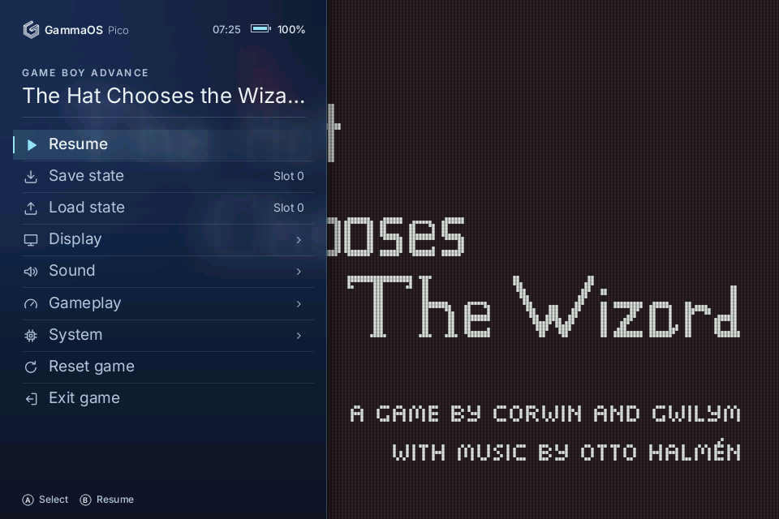
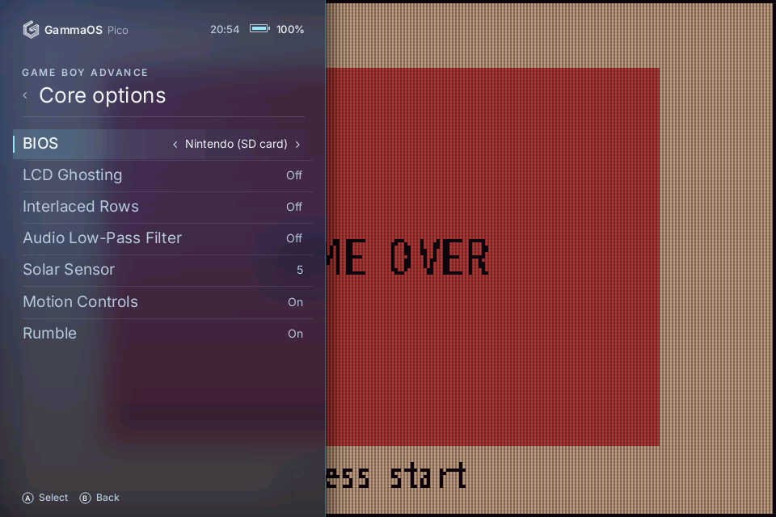
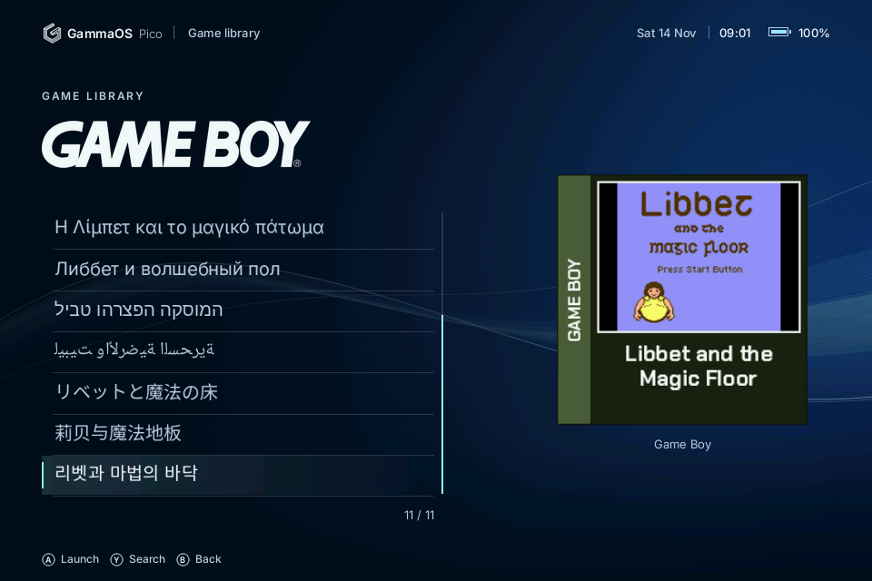
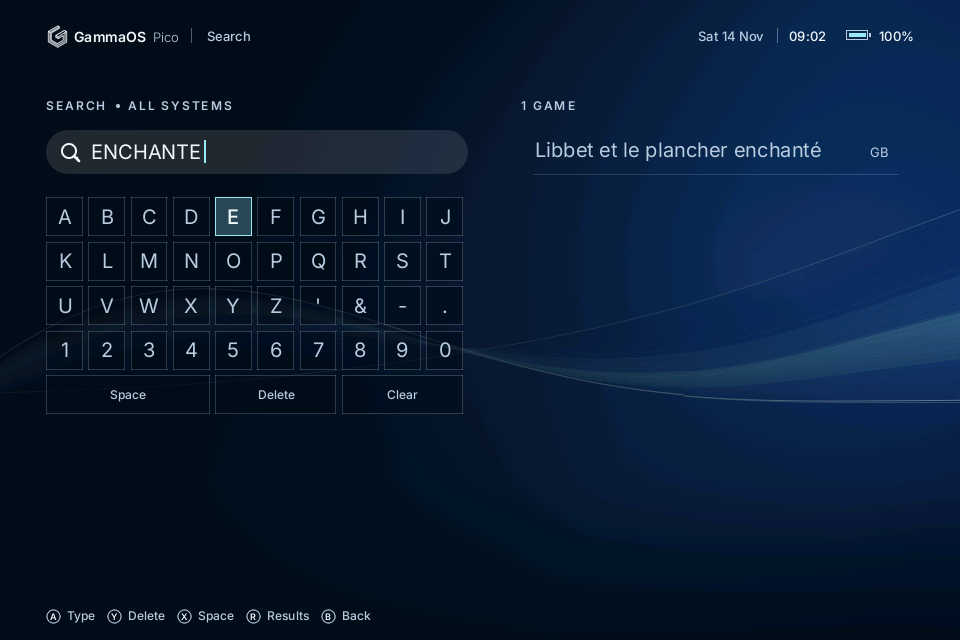

# GammaOS Pico

An offline retro handheld OS for the **Konkr Pocket Advance**, living in the console's bootloader.
It plays your games straight from the microSD card, and leaves the console's Android in place.

## Systems supported

| System | Emulator | Files |
|---|---|---|
| Game Boy Advance | armGBA (default), gpSP | `.gba` |
| Game Boy | gambatte | `.gb` |
| Game Boy Color | gambatte | `.gbc` |
| Super Nintendo (SNES) | snes9x | `.sfc` `.smc` |
| Mega Drive / Genesis | Genesis Plus GX | `.md` `.gen` `.bin` `.smd` |
| Master System | Genesis Plus GX | `.sms` |
| Game Gear | Genesis Plus GX | `.gg` |
| SG-1000 | Genesis Plus GX | `.sg` |

Any of them can also be in a `.zip` or `.7z` archive. Device: the **Konkr Pocket Advance** only.

## Read this first

> [!CAUTION]
> **GammaOS Pico is a custom bootloader. It is experimental software, provided as it is, with no
> warranty of any kind.** Installing it replaces the console's bootloader (the LK, in `lk_a` and
> `lk_b`). Flashing a bootloader can leave a console that does not start, and you do it entirely at
> your own risk. Nobody involved is responsible for a bricked or damaged console, lost data, or
> anything else that comes from installing or using it.

> [!WARNING]
> **The console's Android stays** as it is: pull the card, or pick Boot to Android in the menu,
> and it starts Android. **But Android's over-the-air (OTA) updates may stop working** while
> GammaOS Pico's bootloader is installed, and an OTA may also replace it. **Update the console's
> Android to its latest version before you install GammaOS Pico.**

> [!IMPORTANT]
> **GammaOS Pico is an offline OS, released as it is.** There is no account, no store and no
> network. It is not a community project: **feature requests, issues and pull requests are not
> accepted**, and there is no support channel here. Use it as it is, or not at all.

## Download

The [**Releases**](https://github.com/TheGammaSqueeze/GammaOSPico/releases) page has, for each
version:

- `gammaos-pico-kpa-<version>-flash.zip`: the bootloader, with SP Flash Tool, mtkclient and
  fastboot packages, and the stock bootloader to go back.
- `gammaos-pico-kpa-<version>-sdcard.zip`: the microSD card: the menu, the emulators and a set of
  freely licensed demo games with their box art.
- `gammaos-pico-kpa-windows-tools.zip`: for installing on Windows, SP Flash Tool v5.1924 and
  MediaTek's USB driver, as MediaTek ships them (SP Flash Tool V6 does not work with the packages).

**You install the bootloader with SP Flash Tool v5 (Windows) or mtkclient (Linux).** Both write it
to a stock console without unlocking anything and without erasing your data. fastboot is only for
updates once GammaOS Pico is already on the console, never for the first install. Full steps are
in [Installing](https://github.com/TheGammaSqueeze/GammaOSPico/wiki/Installing).

## How to

Everything is in the [**Wiki**](https://github.com/TheGammaSqueeze/GammaOSPico/wiki), with
screenshots:

- [Before you start](https://github.com/TheGammaSqueeze/GammaOSPico/wiki/Before-You-Start)
- [Installing](https://github.com/TheGammaSqueeze/GammaOSPico/wiki/Installing): formatting the
  card (FAT32 or exFAT), the card's files, and flashing the bootloader with SP Flash Tool or mtkclient
- [Adding games](https://github.com/TheGammaSqueeze/GammaOSPico/wiki/Adding-Games): the folders
  and files it reads, archives, adding folders of your own
- [Box art](https://github.com/TheGammaSqueeze/GammaOSPico/wiki/Box-Art) and the
  [Game Boy Advance BIOS](https://github.com/TheGammaSqueeze/GammaOSPico/wiki/BIOS)
- [Using the menu](https://github.com/TheGammaSqueeze/GammaOSPico/wiki/Using-the-Menu),
  [Settings](https://github.com/TheGammaSqueeze/GammaOSPico/wiki/Settings),
  [the in-game menu](https://github.com/TheGammaSqueeze/GammaOSPico/wiki/In-Game-Menu),
  [buttons](https://github.com/TheGammaSqueeze/GammaOSPico/wiki/Buttons)
- [Updating, and going back to stock](https://github.com/TheGammaSqueeze/GammaOSPico/wiki/Updating-and-Going-Back)
- [Troubleshooting and FAQ](https://github.com/TheGammaSqueeze/GammaOSPico/wiki/Troubleshooting-and-FAQ)

## What it does

- From power on to the Game Boy Advance boot logo in about two and a half seconds; hold Power in
  a game to save your place and switch off, and the next power on goes straight back.
- Low latency: the screen is retimed to each console's real refresh rate, frames are paced to the
  panel and run-ahead hides the games' own lag.
- Sharper motion with black frame insertion: the backlight goes dark for part of every frame, in
  step with the screen, so moving pictures stay crisp instead of smearing (25 %, 50 % or 75 %).
- Rewind, fast forward, save states, screen filters and colour correction.
- Box art, play time and last played for every game; search, A to Z and fast scrolling for
  libraries of thousands of games.
- Games in your own folders, ES-DE or EmuDeck layouts, and `.zip` / `.7z` archives.
- Tilt, gyro and rumble: the console's motion sensor and vibration motor stand in for the
  cartridges' (Yoshi Topsy-Turvy, WarioWare: Twisted!, Kirby Tilt 'n' Tumble, Drill Dozer and the
  Game Boy Color rumble cartridges).
- Headphones: sound moves to the 3.5 mm jack when they are plugged in.
- Game names in any language (accented letters, Greek, Cyrillic, Japanese, Chinese, Korean,
  Hebrew, Arabic), and menus in 17 languages.
- The console's real-time clock for the games that keep time.
- Everything (settings, saves, states, box art) lives on the card.

| | |
|---|---|
|  |  |
| A system's library, with box art and play time | The in-game menu over a game |
|  |  |
| Settings | armGBA's options, with Motion Controls and Rumble |
|  |  |
| Game names in any language | Search finds accented names by their plain letters |

## GammaOS Pico Tool

[**GammaOS Pico Tool**](https://github.com/TheGammaSqueeze/GammaOSPico-Tool) is the desktop
companion for Windows, macOS and Linux: it sets up and updates the card from these releases, lists
your games the way the console does, scrapes box art straight onto the card, and backs up, updates
and restores the console's bootloader once GammaOS Pico is installed.

## Version

Each build shows its version and the commit it was built from in Settings > About (and over
fastboot as `version-gammaos-pico`). This is **GammaOS Pico 1.0.0**.

## Source and licences

The source is at [TheGammaSqueeze/lk-mt6785](https://github.com/TheGammaSqueeze/lk-mt6785)
(branch `lk-gba-emu-sd-card-kpa`); each emulator core is in its own `-pico` repository, linked
from there and from the card's `licences/` folder. The bootloader and the GammaOS Pico additions
are MIT; the emulators and the demo games keep their own licences, which ship with the card.

Game Boy, Game Boy Color, Game Boy Advance and Super Nintendo are trademarks of Nintendo; Mega
Drive, Genesis, Master System, Game Gear and SG-1000 of Sega. GammaOS Pico is not affiliated with
either, nor with Konkr. No commercial games or BIOS files are included: use your own.
